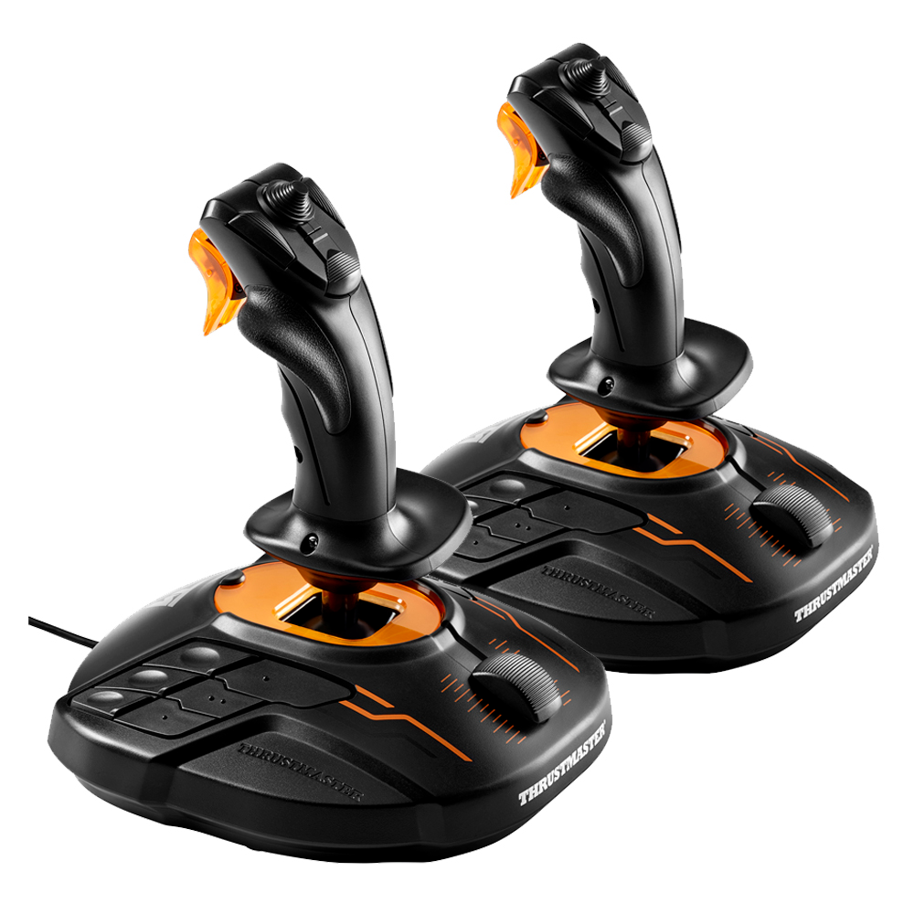
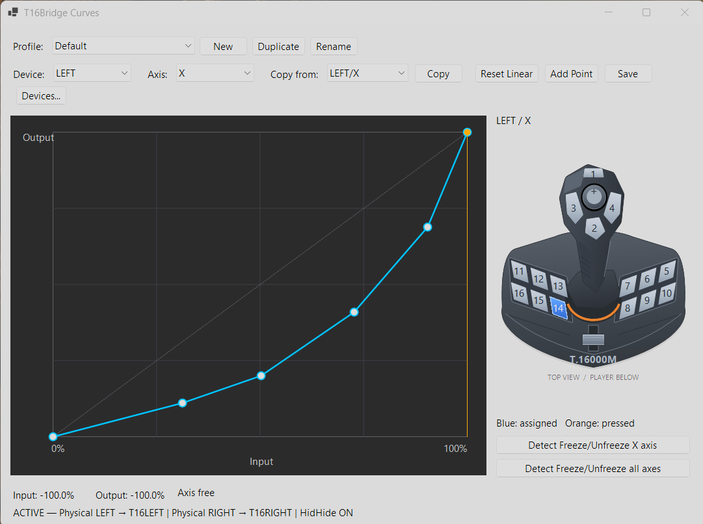

# T16Bridge

☕ [Say thanks on Ko-fi](https://ko-fi.com/yegorvolkov)

<p align="center">
  
</p>

**T16Bridge** makes two identical **Thrustmaster T.16000M** joysticks appear as two independent virtual controllers: `T16LEFT` and `T16RIGHT`.

Release **0.2.0** includes named sensitivity profiles, independent axis and
all-axes freeze bindings, the live controller diagram, and safe shared-driver
cleanup. See the [release notes](docs/releases/0.2.0.md).

## 1. Problem

Some games identify both T.16000M sticks only by the same VID/PID/name and cannot reliably distinguish LEFT from RIGHT.

That means two physical sticks can collapse into one logical device or share bindings incorrectly.

## 2. Solution

T16Bridge creates two separate virtual joysticks:

```text
Physical LEFT  T.16000M -> T16LEFT
Physical RIGHT T.16000M -> T16RIGHT
```

The physical sticks are hidden from games with **HidHide**, while T16Bridge keeps access to them and forwards their input to the virtual devices.

## 3. How it works

On first launch:

1. T16Bridge detects the connected T.16000M devices.
2. You assign them as **LEFT** and **RIGHT** using the built-in input test.
3. T16Bridge creates `T16LEFT` and `T16RIGHT` through HIDMaestro.
4. HidHide automatically allow-lists T16Bridge, hides the two physical sticks, and enables device hiding.
5. Games see the two independent virtual controllers instead of the original identical devices.

Supported input:

- X / Y
- Rz / twist
- Slider
- 16 buttons
- POV hat

Device mapping is saved in `%LOCALAPPDATA%\T16Bridge`.

## 4. Curves

T16Bridge includes a graphical sensitivity-curve editor for every axis on both virtual devices.

<p align="center">
  <a href="assets/t16bridge-curves-profiles.png">
    
  </a>
  <br>
  <em>Custom sensitivity curves, named profiles, and a live controller panel with per-axis and all-axes freeze bindings.</em>
</p>

Features:

- independent LEFT / RIGHT curves;
- live input/output preview;
- draggable control points;
- add/remove/reset points;
- copy a curve between axes or devices;
- mirrored center-to-edge curves for X/Y/Rz;
- no forced deadzone.

### Sensitivity profiles

Use **Profile** to switch between saved setups for both sticks and all eight axes.
**New** starts with linear curves; **Duplicate** copies the current profile's curves
and freeze-button assignments into an independent profile. **Rename** changes its
name. Changes and the active profile are saved automatically in
`%LOCALAPPDATA%\T16Bridge\profiles.json`.

Existing `curves.json` settings are imported into **Default** the first time the
profile library is created. The original file remains untouched.

### Freeze an axis

Select **Device** and **Axis**, then click **Detect Freeze/Unfreeze X axis** (the axis
name follows your selection). Press a physical button on that stick to assign
it. There are no manual button selectors or click-to-assign diagram controls.
Assignments start disabled and are saved with each sensitivity profile.

The controller panel follows LEFT/RIGHT and the selected axis. LEFT shows the
left-handed layout and RIGHT the right-handed layout. Match the physical base
switches to those roles. Blue marks the selected axis's binding and the all-axes
binding; orange marks physical presses.

**Detect Freeze/Unfreeze all axes**, below the axis detection button, assigns a
separate physical button that toggles all four axes of the selected stick. If
some axes are already held, it freezes the remaining axes without moving the
held ones. If all are held, it releases them all. Assignments for LEFT and RIGHT
are independent. A button used for the all-axes action cannot also be used for
an individual axis on the same stick; detecting it for one action clears the
conflicting assignment.

For example, select **LEFT / Y**, click **Detect Freeze/Unfreeze Y axis**, then press
button 1. Lower the collective and press button 1 again to hold its curved output
while moving the stick freely. Another press releases it. Holding the button
does not repeatedly toggle. During detection, existing bindings on that stick
are suppressed; inputs still reach games. Click the active detection button to
cancel. Changing device, axis, or profile also cancels detection.

The live display shows **FROZEN** for the selected axis.
Changing profiles, changing a freeze assignment, or restarting
the bridge clears holds; held positions are never restored from disk. Unlocking
can cause a jump to the current stick position. Assigned buttons still reach the
game, so avoid conflicting in-game bindings.

## 5. Components & automation

The installer deploys the complete required stack:

| Component | Purpose |
| --- | --- |
| **T16Bridge** | Physical-to-virtual bridge and curve editor |
| **HIDMaestro v2.1.0** | Creates `T16LEFT` / `T16RIGHT` virtual HID devices |
| **HidHide v1.5.230** | Hides the two physical T.16000M devices from games |
| **.NET runtime** | Bundled self-contained with T16Bridge |

Installation is designed to be automatic:

```text
Download setup
   -> Agree & Install
   -> first-run LEFT/RIGHT identification
   -> automatic HidHide configuration
   -> done
```

The installer also creates **T16Bridge** shortcuts on the Desktop and in the Start Menu, plus an **Uninstall T16Bridge** Start Menu shortcut.

## 6. Uninstall

Use either:

```text
Start Menu -> T16Bridge -> Uninstall T16Bridge
```

or:

```text
Settings -> Apps -> Installed apps -> T16Bridge -> Uninstall
```

The uninstaller removes T16Bridge and its configuration:

- `T16LEFT` and `T16RIGHT`;
- T16Bridge HidHide rules;
- `%LOCALAPPDATA%\T16Bridge` settings;
- program files and shortcuts.

The shared HIDMaestro driver and HidHide remain installed for other applications.
Cleanup preserves controllers owned by running HIDMaestro applications and leaves
HidHide's global hiding setting unchanged. The HIDMaestro cleanup also sweeps
controllers left by exited applications; it is not restricted to T16Bridge.

Close T16Bridge before uninstalling. When upgrading from 0.1.0, install the new
version over the existing installation rather than running the old uninstaller,
which removes shared components. Start and close the updated T16Bridge once so
it can reclaim its legacy virtual devices before uninstalling it.

## 7. Licenses

T16Bridge is distributed under the **MIT License**.

Third-party components:

- **HIDMaestro** — MIT License
- **HidHide** — MIT License

The installer shows all required components before installation and links to the upstream projects/licenses. Exact third-party license texts are bundled with each release.

See [`THIRD_PARTY_NOTICES.md`](THIRD_PARTY_NOTICES.md) for details.

## Build

Requirements for contributors: Windows x64, .NET 10 SDK, PowerShell, and Inno Setup 6.

```powershell
.\scripts\build-release.ps1
```

Output:

```text
artifacts\installer\T16BridgeSetup-x64.exe
```

The application version in `src/T16Bridge/T16Bridge.csproj` is the release
version. The build passes it to the installer and requires matching notes in
`docs/releases/<version>.md`. A GitHub release tag must be `v<version>` (for this
release, `v0.2.0`); the workflow uses those notes as the release description.

Run the checks with:

```powershell
dotnet run --project tests/T16Bridge.Checks/T16Bridge.Checks.csproj -c Release
```
